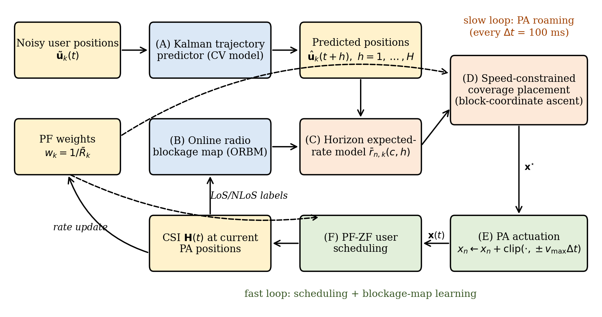

# PRISM — Pinching-Antenna Roaming Simulator

Official code for the paper

> **Predictive Coverage Placement of Pinching Antennas with Finite Movement Speed in Multiuser Mobile Indoor Networks**
> G. Arul Dalton, submitted to *IEEE Transactions on Vehicular Technology*, 2026.

PRISM (Predictive Roaming with Integrated Speed-constrained coverage and Map learning) is a training-free,
two-timescale controller for **multiuser, multi-waveguide pinching-antenna systems (PASS)** in which the
pinching antennas move at a **finite speed**, users are **mobile**, and links are **dynamically blocked**.
This repository contains the complete system-level simulator, PRISM, all baselines (including a NumPy DDPG
agent and a clairvoyant oracle), the trained DDPG models, the raw results, and the scripts that regenerate
every figure and table in the paper.



## Repository layout

```
pass-prism/
├── pass_prism/
│   ├── simulator.py     # geometry, blockage, channel, mobility, PF-ZF scheduler,
│   │                    # Kalman filter, PRISM, ablations and baselines
│   └── extensions.py    # warehouse-aisle scenario, Oracle-PRISM, NumPy DDPG, CI metrics
├── scripts/
│   ├── run_experiments.py   # reproduces every experiment (results/*.json)
│   ├── make_figures.py      # Figs. 3-11 from results/*.json
│   └── make_diagrams.py     # Figs. 1-2 (system model, block diagram)
├── models/              # trained DDPG actors (ddpg_default.npz, ddpg_aisle.npz)
├── results/             # raw results used in the paper (JSON)
├── figures/             # all figures of the paper (PNG, 300 dpi)
├── tests/test_smoke.py  # fast smoke and reproducibility tests
├── reproduce.sh         # full pipeline
└── requirements.txt
```

## Installation

Python ≥ 3.9 and three packages (no GPU, no deep-learning framework needed):

```bash
git clone https://github.com/iitrky/pass-prism.git
cd pass-prism
pip install -r requirements.txt
python tests/test_smoke.py        # ~1-2 min
```

## Quick start

```python
from pass_prism import run, metrics

# one realization of the default 60 m x 12 m hall at 28 GHz
out = run({'P_dBm': 10}, seed=100, schemes=('prism', 'reactive', 'mimo'))
for k, rates in out.items():
    print(k, rates.sum())          # average sum rate (bit/s/Hz)
```

Every simulation parameter (Table II of the paper) is in `pass_prism.simulator.DEFAULT` and can be overridden
through the first argument of `run`. Available schemes (`pass_prism.SCHEMES`):

| Key | Scheme |
|---|---|
| `prism` | PRISM (proposed) |
| `nopred`, `nomap` | PRISM without Kalman prediction / without the online blockage map |
| `hung` | Predictive one-to-one (Hungarian) placement |
| `reactive` | Reactive tracking PASS |
| `ddpg`, `ddpg_aisle` | DDPG PASS (trained actors in `models/`) |
| `oracle` | Oracle-PRISM (true future positions and blockage) |
| `gtrack` | Genie tracking, speed-limited |
| `genie` | Ideal PASS, infinite speed (genie) |
| `blind` | Blind roaming PASS |
| `fixed` | Fixed PASS (waveguide midpoints) |
| `mimo` | Conventional co-located MIMO base station |

## Reproducing the paper

```bash
bash reproduce.sh                                  # everything (several hours on one CPU core)
python scripts/run_experiments.py ablation         # Table III  (20 realizations)
python scripts/run_experiments.py aisle            # Table IV   (12 realizations)
python scripts/run_experiments.py power            # Fig. 3, likewise vpa, length, vuser, users, humans, aisle_speed
python scripts/run_experiments.py train_default    # retrain DDPG (default hall); train_aisle for the aisle scenario
python scripts/run_experiments.py users --quick    # 1-minute smoke run, written to results_quick/
python scripts/make_figures.py && python scripts/make_diagrams.py
```

All runs are seeded (test layouts use seeds 100, 101, ...; DDPG training uses disjoint seeds), so the
numbers below are reproduced exactly. Approximate single-core run times: `ablation` 20 min, `aisle` 10 min,
each sweep 3-6 min, each DDPG training 4 min.

## Main results

**Default scenario** (60 m × 12 m hall, 4 waveguides, 12 users, 28 GHz, 10 dBm, v_max = 2 m/s; 20 realizations):

| Scheme | Sum rate (bit/s/Hz) ± 95% CI | 5th-pct. user rate | Decision time (ms/slot) |
|---|---|---|---|
| **PRISM (proposed)** | 17.33 ± 0.19 | 1.09 | 4.5 |
| Oracle-PRISM (clairvoyant) | 17.51 ± 0.28 | 1.11 | 10.4 |
| PRISM w/o blockage map | 17.73 ± 0.28 | 1.13 | 1.7 |
| PRISM w/o prediction | 17.43 ± 0.19 | 1.10 | 0.8 |
| Reactive tracking PASS | 16.79 ± 0.25 | 1.17 | 0.0 |
| Predictive one-to-one | 16.72 ± 0.34 | 1.04 | 4.1 |
| DDPG PASS | 9.44 ± 0.34 | 0.56 | 0.1 |
| Conventional MIMO BS | 15.36 ± 0.41 | 0.88 | 0.0 |
| Genie tracking (speed-limited) | 15.26 ± 0.22 | 1.04 | 2.1 |
| Blind roaming PASS | 13.09 ± 0.20 | 0.91 | 0.0 |
| Fixed PASS (midpoint) | 12.17 ± 0.31 | 0.75 | 0.0 |
| Ideal PASS (genie, v_max = ∞) | 22.98 ± 0.15 | 1.77 | 2.0 |

**Warehouse-aisle scenario** (2.8-m shelving, lane-following AGVs; 12 realizations):

| Scheme | Sum rate (bit/s/Hz) ± 95% CI | 5th-pct. user rate | Decision time (ms/slot) |
|---|---|---|---|
| **PRISM (proposed)** | 9.83 ± 0.47 | 0.43 | 4.7 |
| Oracle-PRISM (clairvoyant) | 14.53 ± 0.65 | 0.50 | 41.7 |
| PRISM w/o blockage map | 9.90 ± 0.87 | 0.39 | 1.6 |
| PRISM w/o prediction | 10.07 ± 0.99 | 0.37 | 0.8 |
| Reactive tracking PASS | 8.93 ± 0.79 | 0.42 | 0.1 |
| DDPG PASS | 7.85 ± 0.41 | 0.35 | 0.1 |
| Conventional MIMO BS | 3.25 ± 0.41 | 0.01 | 0.0 |
| Fixed PASS (midpoint) | 8.21 ± 0.37 | 0.44 | 0.0 |

Key findings: the gain of PRISM comes from its speed-constrained **coverage objective**; one-to-one tracking
is penalized by an average re-association travel time of L/(3 v_max). Kalman prediction and the online blockage
map give no statistically significant gain in the tested scenarios, while the clairvoyant oracle reveals large
headroom in the warehouse scenario. The DDPG agent was trained with a modest budget (60 000 transitions) and
should be read as a lower reference point for learning-based control.

## Citation

If you use this code, please cite the paper (see also `CITATION.cff`):

```bibtex
@article{aruldalton2026prism,
  author  = {G. Arul Dalton},
  title   = {Predictive Coverage Placement of Pinching Antennas with Finite Movement Speed in Multiuser Mobile Indoor Networks},
  journal = {IEEE Transactions on Vehicular Technology},
  year    = {2026},
  note    = {Submitted}
}
```

## License

MIT License — see `LICENSE`.

## Contact

Dr. G. Arul Dalton, Department of Computer Science and Engineering, Saveetha Engineering College, Chennai, India —
aruldalton@saveetha.ac.in — ORCID [0000-0002-5981-7176](https://orcid.org/0000-0002-5981-7176)

## Revision v3: multiple PAs per waveguide, WA-ORBM, TD3, DP optimum

`pass_prism/v3.py` adds multiple segment-confined PAs per waveguide (`prismM{M}`, `reactM{M}`, `fixedM{M}`),
the waveguide-aware blockage map (`prism3`), a NumPy TD3 baseline, the exact speed-limited optimum by dynamic
programming (`dp_experiment`), and partial oracles (`or_pos`, `or_blk`). Reproduce with

```bash
python scripts/run_v3.py train_td3_default    # TD3 agent -> models/td3_default.npz
python scripts/run_v3.py main                 # Table III (20 realizations)
python scripts/run_v3.py aisle --seeds 8      # Table IV, Fig. 6
python scripts/run_v3.py dp                   # DP optimum (20 realizations)
python scripts/run_v3.py mv2                  # Fig. 4 (PAs per waveguide x PA speed)
python scripts/run_v3.py length3              # Fig. 5 (hall length)
python scripts/make_figures_v3.py             # figures/v3/
```

Results used in the revised manuscript are in `results/v3/`.
